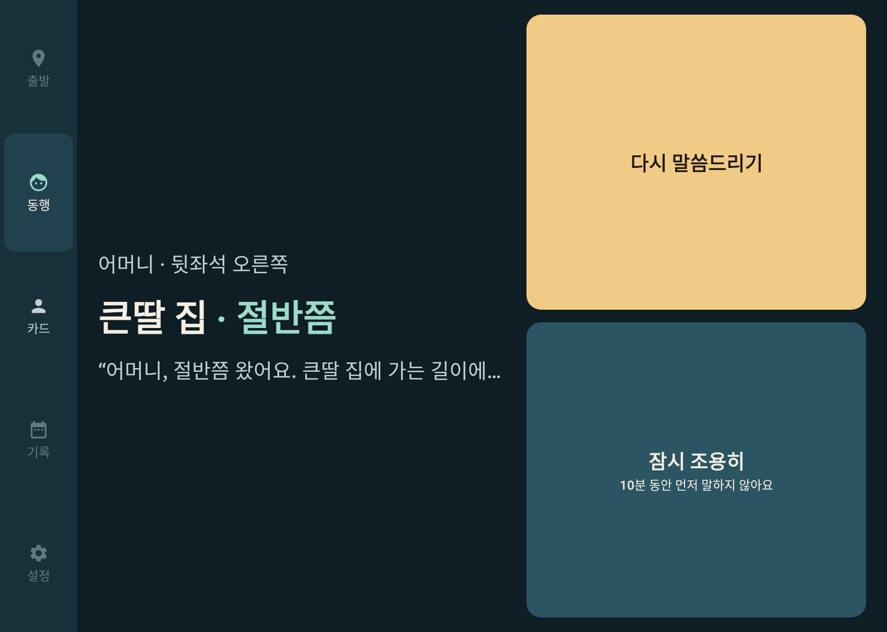
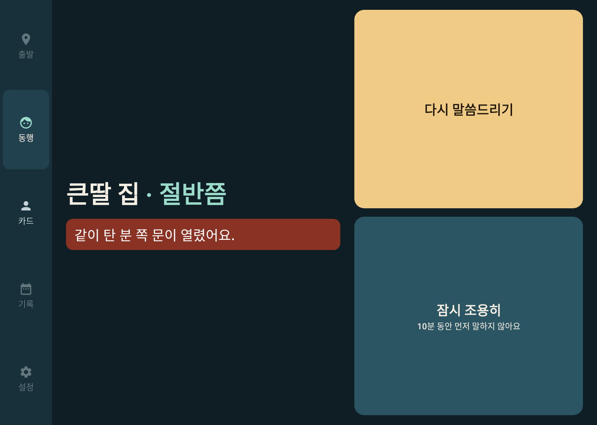
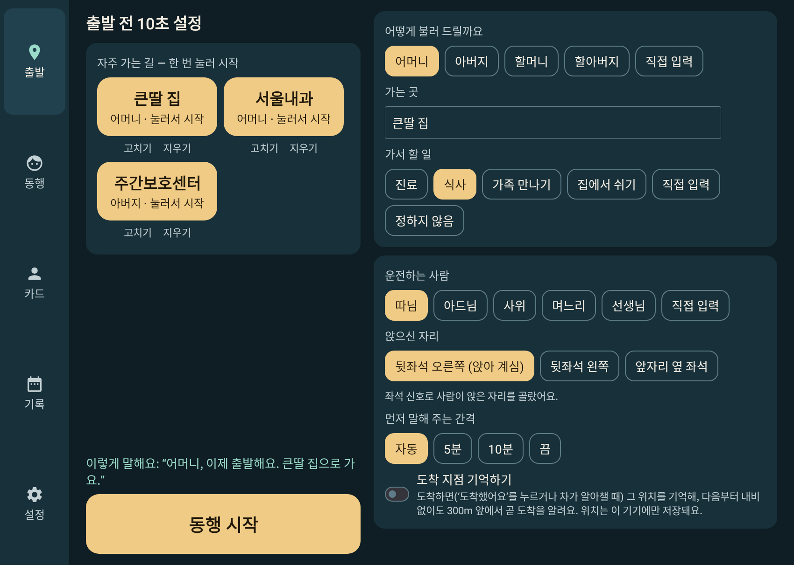
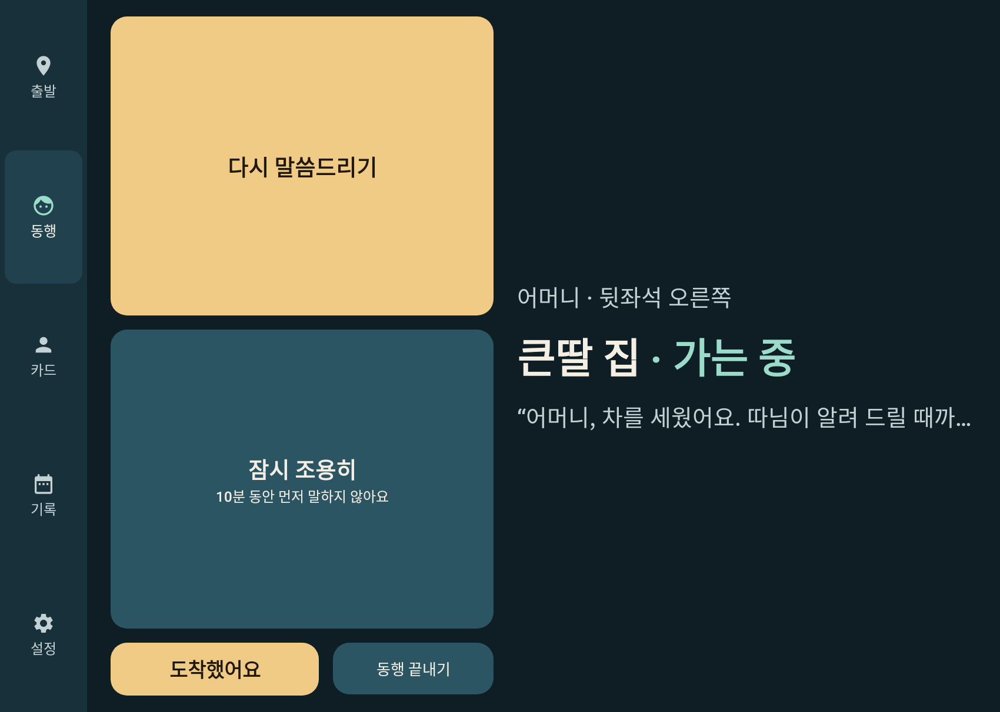
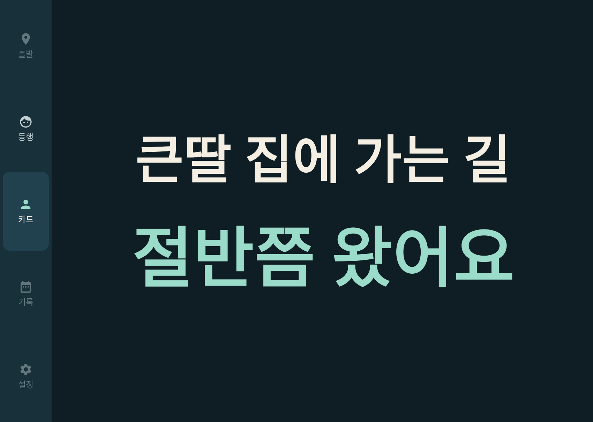
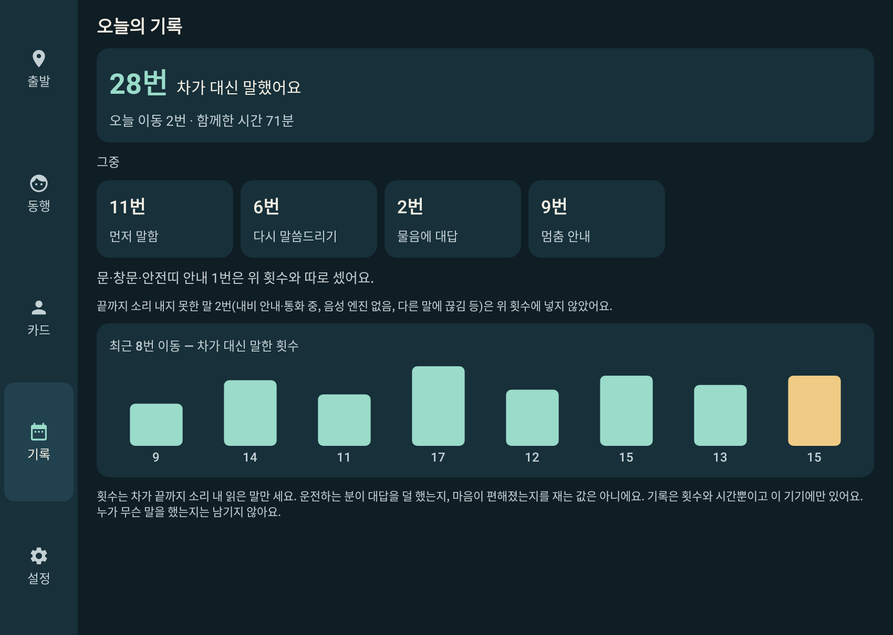

# 몇 번이든

> 내비의 남은 길과 좌석·문·창문 신호를 연동해, 기억이 흐려진 부모님이 "어디 가?"를 몇 번 물으셔도
> 차가 그 자리에서 매번 처음처럼 대답하고, 운전하는 가족은 앞만 보게 하는 동행 앱.

현대자동차그룹 Pleos Connect(AAOS) 용 앱입니다. 패키지 `app.myeotbeonideun`, 버전 1.0.0.

| 동행 중(주행 중에도 쓰는 화면) | 주행 중 문 열림 |
|---|---|
|  |  |

| 출발 전 10초 설정 | 내비 없는 길에서 정차 — 운전자가 '도착했어요'로 알림 |
|---|---|
|  |  |

| 동승자 카드 | 오늘의 기록 — 차가 대신 말한 횟수 |
|---|---|
|  |  |

화면 그림 18장은 [`docs/screens/`](docs/screens)에 있습니다. **에뮬레이터 캡처가 아니라**, 실제 Compose 화면을
JVM 에서 그려 뽑은 것입니다(`ScreenshotTest`, Roborazzi). 화면 속 안내 문장은 엔진에 신호를 넣어 얻은 실제 출력입니다.
Pleos Connect 에뮬레이터에서 실제로 확인한 것은 아래 '테스트 환경'에 따로 적었습니다.

## 무엇을 하나

차만 아는 사실을, 차가 대신 말합니다.

| 순간 | 차가 아는 것 | 차가 하는 말(예) |
|---|---|---|
| 몇 분마다 "어디 가?", "언제 도착해?" | 내비의 목적지와 남은 시간 | "어머니, 절반쯤 왔어요. 큰딸 집에 가고 있어요." |
| 차가 서면 "다 왔어?" 하며 내리려 함 | 주행 단에서 20초 넘게 섬(속도 신호를 허용했으면 속도로, 아니면 브레이크를 밟고 있는 것으로 봄) | "어머니, 잠깐 신호를 기다려요. 아직 가는 중이에요." |
| 내비 없이 간 길에서 P단으로 섬 | P단, 내비 정보 없음 — 도착인지 모름 | "어머니, 차를 세웠어요. 따님이 알려 드릴 때까지 앉아 계세요." 운전자가 `도착했어요`를 누르면 "어머니, 큰딸 집에 다 왔어요. 따님이 올 때까지 앉아 계세요." |
| 운전자가 잠깐 내림 | P단 + 운전석 문 열림 + 운전석 비움 + 동승 좌석 점유 | "어머니, 따님이 잠깐 내렸어요. 금방 돌아와요." |
| 운전자가 없는 동안 동승자가 문을 엶 | 운전자 이탈 중 그 좌석 문 열림 | 동승자: "어머니, 앉아서 따님을 기다려요." / 돌아온 운전자: "차에서 내린 사이 같이 탄 분 쪽 문이 열렸어요." |
| 주행 중 문 손잡이를 당김 | 그 좌석 문 열림 | 운전자: 화면의 붉은 한 줄과 알림음 / 동승자: "어머니, 문은 닫아 주세요. 아직 가는 중이에요." |
| 창문을 내림 | 그 좌석 창문 30% 이상(설정 가능) | "어머니, 창문이 열렸어요. 손은 안에 두세요." |

위 문장은 모두 대본 파일에 실제로 들어 있는 첫째 변형입니다(빈칸은 어머니·큰딸 집·따님).

대답의 경로는 셋입니다.

1. **먼저 말해 주기** — 구간(방금 출발 / 가는 중 / 절반 / 거의 다 옴 / 곧 도착 / 도착)이 바뀔 때와 일정 간격마다.
2. **운전자가 시키기** — 큰 버튼 `다시 말씀드리기`, 또는 Gleo 로 "어머니께 다시 말씀드려 줘". 정차 중에는 `도착했어요`로 도착을 알립니다.
3. **물으면 대답하기(실험 기능, 기본 꺼짐)** — 음성 인식으로 다섯 가지 물음을 알아듣고 대답. 꺼져 있어도 1·2로 앱이 섭니다.

말은 미리 써 둔 고정 대본(`app/src/main/assets/scripts_ko.json`, 40개 상황 132줄)입니다. 실행 중에 생성형 AI 로 문장을 만들지 않습니다.
같은 물음에는 같은 사실을 표현만 바꿔 말하고(동승자에게 하는 말은 상황마다 4개, 운전자 알림 6개 상황과 카드 8개 상황은 2개씩),
"아까 말씀드렸잖아요" 같은 말은 대본 검사기가 막습니다.
시간은 분 숫자가 아니라 "절반쯤", "거의 다 왔어요" 같은 말로 전하고, 숫자는 남은 시간이 3~5분일 때의 "5분쯤" 하나뿐입니다.

## 실행 방법

필요한 것: JDK 17, Android SDK(platform 34, build-tools 34). 인터넷(의존성과 Pleos SDK 를 Maven 에서 받습니다).

```bash
# local.properties 에 SDK 위치를 적는다:  sdk.dir=<Android SDK 경로>
./gradlew testDebugUnitTest      # 단위 테스트(엔진 + 앱)
./gradlew assembleDebug          # app/build/outputs/apk/debug/app-debug.apk
./gradlew assembleRelease        # app/build/outputs/apk/release/app-release.apk
```

설치와 실행(Pleos Connect 에뮬레이터 또는 기기):

```bash
adb install -r "apk/개인참가_몇번이든_release.apk"        # 저장소에 든 제출용 APK
# 또는 직접 빌드한 것: adb install -r app/build/outputs/apk/release/app-release.apk
adb shell am start -n app.myeotbeonideun/.ui.MainActivity
```

차량용(Android Automotive) 앱입니다. 매니페스트가 `android.hardware.type.automotive` 를 필수로 적어, 앱 마켓에서는 차량용 기기에만 보입니다.
adb 로 차량용이 아닌 기기에 설치하면 체험 모드로만 돌도록 만들었습니다(Robolectric 시험으로 확인, 실제 휴대폰에서는 해 보지 않음).
차량용 기기에서는 차량 신호를 받지 못해도 체험 모드로 넘어가지 않습니다(아래 '체험 모드').

가상 콘솔로 시연하는 순서는 [`docs/demo.md`](docs/demo.md)에, 그 순서를 단계마다 가상 콘솔에 보내는 시연 도우미는
[`tools/demo_console.py`](tools/demo_console.py)(HTTP 만 쓰고 adb 는 쓰지 않음, `python tools/demo_console.py`)에 있습니다.

릴리스 서명 값은 저장소 밖의 `keystore.properties`(storeFile, storePassword, keyAlias, keyPassword)에서 읽습니다.
위치는 `-Pmyeotbeon.signing=<파일>`, 환경변수 `MYEOTBEON_SIGNING`, `local.properties` 의 `myeotbeon.signing=<파일>`,
프로젝트 루트의 `keystore.properties` 순으로 찾습니다. 없으면 서명 없는 release 가 만들어집니다.

## 테스트 환경과 필요한 설정

**Pleos Connect Emulator v2.1.0(Android 14)에서 확인한 것**(2026-11-11, x86_64, Windows 하이퍼바이저 가속, 커밋 40f6371 의 release 빌드)

- 설치·실행, 첫 실행 안내와 출발 전 설정 화면.
- 차량 신호 10종 연결(좌석 점유·문·창문·안전띠·브레이크·변속단·주행 규제·내비·위치, 속도는 권한을 허용한 뒤). Pleos SDK 콜백이 실제로 온다.
- Pleos 기기 안 TTS(ON_DEVICE)로 소개말과 안내를 소리 내어 읽음.
- D단: 출발 안내, 주행 규제(`CarUxRestrictions`) 수신과 정차 전용 화면 잠금, '동행 끝내기' 숨김.
- `다시 말씀드리기` 두 번에 같은 사실을 다른 표현으로.
- 속도 40 → 0 + 브레이크로 20초 정지 → 신호 대기 안내.
- 주행 중 창문 40%(원시 값 4, 0~10 눈금)·문 열림 → 운전자 화면 알림과 동승자 안내.
- 운전자 이탈·복귀 안내(좌석 값 극성 보정 전 빌드라 가상 콘솔에 반대로 넣어 확인).
- 내장 내비에서 검색한 목적지와 남은 시간(단위 초: 9분 경로 = 540).
- 동행을 마친 뒤 오늘의 기록과 '자주 가는 길' 저장.
- Gleo 와 같은 꼴의 방송(`REPEAT_TRIP_ANSWER`)으로 다시 말하기와, 앱의 응답을 Gleo 프로세스가 받는 것.

이 검증에서 JVM 시험이 못 잡은 치명 결함을 찾아 고쳤습니다: 대본 빈칸 정규식이 안드로이드(ICU)에서만 컴파일 오류를 내어, 가는 곳을 입력하거나
체험 모드를 켜는 순간 앱이 종료됐습니다(커밋 40f6371, 회귀 시험 `RegexPortabilityTest`). 같은 검증에서 좌석 점유 값이 가상 콘솔과 반대로 오는 것도
찾았습니다(아래 '알려진 한계').

**그 뒤에 고친 것**(좌석 값 극성 보정, `도착했어요`, 내비 없는 길의 정차 문장, 소리 낸 말만 세는 기록, 내비 음성 안내·통화 양보, 실차 기준 주행 중 잠금,
구독 수명, 속도 권한 권유, 화면 뒤의 급한 알림, 음성 인식 규칙 등)은 빌드와 **JVM 단위 테스트 355개(엔진 166, 앱 189)** 로 확인했습니다.
최종 빌드의 에뮬레이터 확인: 제출 직전 갱신.

**확인하지 못한 것**: 실차. 내비 도착 이벤트와 남은 시간에 따른 구간 변화(이 에뮬레이터는 내비 위치가 움직이지 않음). 내비 남은 거리의 단위.
Gleo 음성으로 함수가 불리는 경로. 음성 인식이 알아들은 문장과 대답(녹음·인식 시작까지만 확인). 안전띠 값의 극성과 실차의 좌석 값 극성.
내비 음성 안내와 겹칠 때. 다른 앱이 앞에 있을 때의 안내 유지와 헤드업 알림. 근접 알림. 오디오 존 번호. 주행 중 CPU·메모리.

| 항목 | 값 |
|---|---|
| 확인한 환경 | Pleos Connect Emulator 2.1.0 (Android 14, API 34, x86_64), 화면 2560x1440 160dpi |
| 대상 | 위 에뮬레이터 / 실차(arm64-v8a, 실차에서는 실행해 보지 못함) |
| 빌드 | Gradle 8.9, Android Gradle Plugin 8.5.2, Kotlin 2.0.20, JDK 17 |
| SDK | compileSdk·targetSdk 34, minSdk 28 |
| Pleos SDK | Vehicle 2.3.2, NaviHelper 3.0.5, TextToSpeech 3.3.1, SpeechToText 3.3.1, FusedLocation 1.1.3 |
| UI | Jetpack Compose (BOM 2024.09.03), Material 3 |

에뮬레이터 설정(Pleos 문서와 2026-11-11 확인)

- AVD: Automotive > Pleos Connect v2.1.0, **Cold boot**(빠른 부팅이면 차량 신호를 쓸 수 없음), RAM 4GB 이상.
- 가상 콘솔: `adb forward tcp:8088 tcp:8088` 뒤 브라우저에서 `http://127.0.0.1:8088/`. HTTP 로 바꿀 때는 3초 안에 한 번씩
  브라우저 세션(`POST /browser/session?client=…`)을 살려 둬야 합니다(`docs/demo.md`).
- 음성 인식을 시험하려면 Extended Controls > Microphone 에서 호스트 마이크를 켭니다.
- 주행 규제만 켜고 끄기: `adb shell cmd hmg_car_service --service drivingstate driving_regulation on|off`.

시연 순서는 [`docs/demo.md`](docs/demo.md)에 있습니다.

## APK 위치

- 제출용: [`apk/개인참가_몇번이든_release.apk`](apk) — 서명된 release(APK Signature Scheme v2), x86_64 + arm64-v8a, minSdk 28
- 직접 빌드하면: `app/build/outputs/apk/release/app-release.apk`
- 크기·SHA-256: 제출 직전 갱신
- Pleos SDK 의 aar·jar 는 저장소에 넣지 않았지만(라이선스, 빌드할 때 Pleos Maven 저장소에서 받음), 이 APK 에는 빌드 결과로 SDK 코드와
  네이티브 라이브러리가 들어 있습니다.

## 차량 신호 대응 표

읽기(조회)만 합니다. 차량 제어(set), 경고등(telltale), LLM 은 쓰지 않습니다.
API 이름·권한·문서 주소와 에뮬레이터 실측은 [`docs/signals.md`](docs/signals.md)에 있습니다.

| 기능 | 신호 | SDK·API |
|---|---|---|
| 앉은 자리 자동 선택, 운전자 이탈·복귀 | 좌석 점유(운전석 포함, 극성은 운전석 기준으로 맞춤) | Vehicle `getSeat()` · `registerSeatOccupancy` |
| 주행 중 문 열림 알림, 운전자가 없는 동안의 문 | 문 위치 | Vehicle `getDoor()` · `registerDoorPosition` |
| 창문 열림 안내 | 창문 위치 | Vehicle `getWindow()` · `registerWindowPosition` |
| 안전띠 권유(지원 차종만) | 안전띠 체결 | Vehicle `getSeat()` · `registerSeatBeltBuckledState` |
| 신호 대기·정체 판단 | 브레이크 페달, 변속단, 속도 | Vehicle `getBrake()` · `registerBrakePedalStatus`, AAOS `CarPropertyManager`(GEAR_SELECTION, PERF_VEHICLE_SPEED) |
| 주행 중 화면 잠금 | 주행 규제(없으면 변속단) | AAOS `CarUxRestrictionsManager` |
| 어디·얼마나, 도착 | 목적지 이름·남은 시간(초)·도착·정체 요약 | NaviHelper `NaviHelperEventListener` |
| 내비 없이 자주 가는 곳 | 도착했을 때의 위치 → 다음부터 근접 알림(300m) | FusedLocation `getLastKnownLocation` · `addProximityAlert` |
| 말하기 | — | TextToSpeech(ON_DEVICE) → 실패하면 안드로이드 TextToSpeech, 내비 안내·통화 양보, 오디오 포커스 |
| 알아듣기(실험) | — | SpeechToText(ON_DEVICE) |
| 앱이 뒤에 있을 때의 급한 운전자 알림 | — | 안드로이드 알림(중요도 높음 채널의 한 줄) |
| 음성 비서 | — | Gleo App Schema 함수 3개(`assets/schema.json`) |

Vehicle SDK 는 `check*Capabilities` 로 지원 여부와 지원 영역을 확인한 뒤 그 자리만 등록하고, 확인·조회·리스너마다 `onFailed` 를 처리합니다.
NaviHelper·FusedLocation·TextToSpeech·SpeechToText 는 확인 방법이 달라(초기화 콜백이나 예외) [`docs/signals.md`](docs/signals.md)에 따로 적었습니다.
실패한 연결은 2·4·8초 간격으로 세 번까지 다시 시도합니다. 차가 주지 않는 신호가 있으면 그 신호를 쓰는 기능만 꺼지고 나머지는 그대로 동작합니다
(환경설정 > 차량 신호에서 무엇이 잡혔는지 보입니다). 차량 신호는 앱 화면이 보이거나 동행 중일 때만 구독합니다.

## 체험 모드

같은 엔진을 모의 신호로 돌려 볼 수 있습니다.

- 차량용이 아닌 기기는 체험 모드로만 돕니다. 차량용 기기에서는 환경설정에서 켤 때만 체험 모드입니다.
  차량 신호를 하나도 얻지 못해도 넘어가지 않고 '차량 신호 없음'으로 돌며(환경설정과 동행 화면에 알림, 앱을 다시 열 때마다 다시 연결),
  그때 차는 출발을 알 수 없어 먼저 말하지 않고 `다시 말씀드리기`에 어디 가는지만 대답합니다.
- 화면에 항상 `체험 모드` 표시가 붙습니다. 실제 차량 신호가 아님을 밝히기 위해서입니다.
- 체험 모드여도 실제 차가 주행 중이면(주행 규제, 없으면 변속단이 P 가 아님) 출발 전 설정·기록·환경설정·개발자 패널이 잠깁니다.
- 환경설정 > 개발자 패널에서 기어·브레이크·좌석·문·창문·안전띠·내비 값을 손으로 바꾸거나,
  `시연 재생`으로 시연 순서(약 2분 30초)를 그대로 돌립니다.
- 넓은 창에서는 개발자 패널 옆에 동행 화면이 함께 보여, 신호를 바꾸면서 반응을 바로 확인할 수 있습니다.
- 신호 출처만 다르고(`DemoSignalSource` ↔ `PleosSignalSource`) 엔진·음성·화면·저장은 같은 코드입니다.

## 알려진 한계

정직하게 적습니다.

- **실차에서는 실행해 보지 못했습니다.** 에뮬레이터에서 확인한 범위와 확인하지 못한 것은 위 '테스트 환경'에 있습니다.
  Pleos SDK 를 부르는 코드(`PleosSignalSource`, `CarApiBridge`, 음성)는 JVM 시험이 없습니다. 판단 규칙은 순수 Kotlin 으로 빼서 시험하고,
  SDK 호출은 에뮬레이터에서만 확인합니다.
- **좌석 점유 값의 극성**: 에뮬레이터에서는 가상 콘솔과 반대로 왔습니다. 앱은 출발 전 설정과 동행을 시작할 때 운전석에 사람이 있다고 보고 자동으로 맞추며,
  환경설정에서 '그대로/반대로'로 고정할 수 있습니다. 운전자가 밖에 있는데 동승자가 화면을 눌러 시작하면 반대로 정해질 수 있습니다.
  실차의 극성과 안전띠 값의 극성은 확인하지 못했습니다.
- **내비 없이 가는 길**에서는 차가 도착을 스스로 알지 못합니다. P단으로 서면 도착을 부정하지 않는 말을 하고, 운전자가 `도착했어요`로 알립니다.
  '도착 지점 기억하기'를 켠 길은 한 번 도착한 뒤부터 300m 근접 알림으로 곧 도착을 압니다(근접 알림은 확인하지 못함).
- **내비 값**: 남은 시간의 단위는 초로 확인했고, 남은 거리는 미터로 가정했습니다. 엔진은 표본 하나로 구간이나 도착을 정하지 않습니다
  (같은 판단이 두 번 연달아 또는 10초. 남은 시간이 작아도 남은 거리가 300m 넘게 남았으면 근처로 보지 않고, 남은 거리 0 은 도착 이벤트 없이는
  받지 않음). 이 에뮬레이터에서는 내비 위치가 움직이지 않아 구간 변화와
  내비 도착 이벤트를 보지 못했습니다.
- **정지 판단**: 앱이 아는 것은 '주행 단에서 20초 넘게 섬'이고, 속도 신호를 허용하지 않은 기본 상태에서는 '주행 단에서 브레이크를 20초 넘게 밟고 있음'입니다.
  그래서 서행 중 브레이크를 오래 밟아도 선 것으로 보고, 오토홀드로 발을 떼고 서 있으면 모릅니다(첫 실행 안내에서 속도 신호 허용을 권합니다).
  선 이유가 신호인지는 차도 모르므로 신호 대기와 정체의 구별은 추정입니다. 내비가 경로 정체를 알리면 "길이 막혀요"로 말합니다.
- **차량 신호 없음**: 차량용 기기에서 신호를 하나도 얻지 못하면 차가 먼저 말하지 않습니다(시간만으로 출발했다고 하지 않게 했습니다).
- **물으면 대답하기**: 누가 한 말인지 가리지 못해 운전자의 통화나 라디오의 같은 말에도 대답할 수 있습니다(같은 물음에는 18초 안에 다시 대답하지 않음,
  낱말 하나로는 대답하지 않음). 에뮬레이터에서는 녹음과 인식이 시작되는 것까지만 확인했습니다.
- **내비 음성 안내·통화와 겹칠 때**: 말하기 전에 내비 길 안내나 통화가 재생 중이면 최대 8초 기다리고, 그래도 나면 그 말은 소리 내지 않고 화면에
  까닭과 함께 남깁니다(급한 안전 알림은 기다리지 않음). 차의 오디오 포커스 정책 값과 실제로 겹치는 경우는 확인하지 못했습니다.
- **운전자 알림**: 급한 알림(주행 중 문 열림, 운전자가 없는 동안의 문·자리)은 앱이 화면 뒤에 있으면 한 줄 알림(헤드업)으로도 띄웁니다. 주행 중 헤드업을
  어떻게 보일지는 차의 시스템 UI 가 정하고(줄이거나 글을 자를 수 있음), 안드로이드 13 이상에서는 알림 권한을 허용해야 보입니다. 에뮬레이터에서 아직
  보지 못했습니다. 창문 같은 급하지 않은 알림은 앱 화면에만 있습니다. 알림음은 차의 스피커로 나 동승자에게도 들립니다.
- **Gleo**: `schema.json` 과 수신·응답 코드는 문서대로 넣었지만, 스키마는 "검토·승인 후 활성화"라 Gleo 음성으로 함수가 불리는지는 확인하지 못했습니다.
  함수를 받는 리시버와 '동행 시작' 화면은 권한 없이 열려 있습니다(Gleo 가 어떤 권한·패키지로 보내는지 문서에 없음). 그래서 기기 안의 다른 앱도
  동행 중 '다시 말씀드리기'·'다 왔다고 말하기'·'잠시 조용히'와 정차 중 '동행 시작'을 부를 수 있습니다. 동행이 없으면 앞의 셋은 아무 일도 하지 않고,
  '다 왔다고 말하기'와 '동행 시작'은 정차 중에만 받으며, 짧은 사이에 거듭 부르면 받지 않고(말하기 4초에 한 번·1분에 네 번, 동행 시작 10초에 한 번·10분에 세 번),
  응답 방송에는 가는 곳 이름을 싣지 않습니다.
- **좌석별 스피커**: `TextToSpeech.setAudioZoneId(zoneId)` 는 넣었지만 차종별 존 번호가 문서에 없어, 환경설정에서 번호를 고르게 했습니다. 기본은 차 전체 스피커입니다.
- **말 빠르기**: Pleos TTS 에는 빠르기를 정하는 API 가 없어, 문장을 하나씩 끊어 읽고 사이에 쉼을 두는 방식으로 천천히 전합니다.
- **안전띠**: 가상 콘솔에는 좌석별 안전띠 값이 없어, 안전띠 권유는 체험 모드(모의 입력)로만 시연할 수 있습니다.
- **인터넷 권한**: 앱 매니페스트에는 넣지 않았습니다. 다만 Pleos TextToSpeech·SpeechToText SDK(와 그 안의 universal-access)가 병합 매니페스트에 `android.permission.INTERNET` 을 넣어, **설치된 APK 에는 이 권한이 있습니다.** 앱은 두 SDK 를 ON_DEVICE 모드로만 쓰고, 앱 코드에는 네트워크 호출이 없습니다. SDK 안쪽의 동작과, Pleos TTS 를 못 쓸 때 쓰는 기기의 기본 TTS 엔진의 동작은 앱이 확인할 수 없습니다.
- **대본 검수**: 대본은 돌봄 지침을 바탕으로 미리 써 둔 초안이고 규칙 검사기(금지어, 문장 길이, 조사)를 통과했습니다. 다만 사람이 소리 내어 읽거나 실제 차량 음성으로 들어 보는 검수, 어르신·보호자와 함께하는 검수는 아직 하지 못했습니다.
- **이름 길이**: 문장 길이 규칙(한 문장 18음절)은 예시 이름과 흔한 이름 120가지 조합으로 검사했습니다. 직접 입력한 이름이 길면(호칭·운전자 6음절 이상, 가는 곳 8~9음절 이상) 넘는 문장이 생깁니다.
- **APK 크기**: release 약 38MB(정확한 값은 'APK 위치'). Pleos SDK 의 난독화 규칙을 실차에서 검증하지 못해 코드 축소(R8)를 켜지 않았습니다.
- 이 앱은 **안전장치가 아닙니다.** 문과 창문이 열리는 것을 막지 못하고 알릴 뿐입니다. 뒷문 어린이 보호 잠금과 창문 잠금을 함께 쓰도록 앱 안에서 안내합니다.
- 효과에 대해서는 "차가 대신 말한 횟수"(먼저 말하기·다시 말씀드리기·물음 대답·멈춤 안내 가운데 끝까지 소리 낸 말)까지만 말합니다.
  운전자가 대답을 덜 했는지, 불안이 줄었는지는 재지 않으며, 치료 효과가 있다고 주장하지 않습니다.

## 개인정보

- 서버가 없습니다. 앱 코드는 네트워크로 아무것도 보내지 않습니다(SDK 가 넣는 인터넷 권한은 위 '알려진 한계' 참고).
- 목소리를 녹음하지 않습니다. 음성 인식(실험 기능)의 인식 문장은 물음의 종류 다섯 가지 중 하나로 바꾼 뒤 곧바로 버리고, 저장하지도 로그에 남기지도 않습니다.
- 기기에 남는 것은 자주 가는 길(호칭·가는 곳 이름·가서 할 일과 직접 쓴 한마디·운전하는 사람·자리·간격, 그 길을 쓴 횟수와 마지막으로 쓴 시각,
  '도착 지점 기억하기'를 켠 길은 도착 지점 좌표), 이동 기록(시작 시각·걸린 시간·여섯 가지 횟수), 환경설정입니다. `환경설정 > 모두 지우기`로 지웁니다.
- 사용자 허용이 필요한 권한은 셋입니다: 위치(`pleos.car.permission.FUSED_LOCATION`, '도착 지점 기억하기'를 켤 때), 속도(`android.car.permission.CAR_SPEED`,
  첫 실행 안내에서 권함 — 허용 창은 '위치 정보'로 뜸), 알림(`android.permission.POST_NOTIFICATIONS`, 안드로이드 13 이상, 동행을 시작할 때). 나머지는 설치 때 주어집니다.
- 클라우드 백업과 기기 간 이동에서 앱 데이터를 제외했습니다.
- 앱 이름과 화면에 병명이나 환자라는 말이 없습니다(단위 테스트로 검사).

자세한 내용은 [`docs/privacy.md`](docs/privacy.md).

## 테스트

```bash
./gradlew testDebugUnitTest                              # 전체
./gradlew :app:testDebugUnitTest -Proborazzi.test.record=true   # 화면 그림을 docs/screens 에 다시 뽑기
./gradlew :engine:validateScript                         # 대본이 말의 원칙을 지키는지 검사(-Pfile=<대본 파일>)
./gradlew :engine:test -PscriptFile=<대본 파일>            # 다른 대본으로 엔진 테스트 전체를 돌려 보기
python tools/demo_console.py --selftest                  # 시연 도우미를 가짜 가상 콘솔로 시험
```

- **엔진(순수 Kotlin, 166개)**: 구간 경계와 내비 표본 확인·새 경로·남은 시간 0, 목적지 근처의 시간·거리 확인, 간격 계산, 쿨다운, 멈춤 이유 분류(내비 없는 길의 정차·경유지 정차 포함),
  운전자 이탈·복귀와 이탈 중 문·자리, 좌석 흔들림 완충, 도착(내비·근접·운전자 알림)과 도착 거두기, 주행 중 신호가 끊길 때, 기록은 소리 낸 말만,
  조사 처리, 대본 선택의 결정성, 전체 대본의 규칙 검사, 금지어·직접 쓴 한마디 검사, 우선순위(안전 알림 > 멈춤 > 대답 > 먼저 말하기)와 '잠시 조용히',
  물음 꼴(통화·라디오 문장에 대답하지 않음), 정규식이 안드로이드(ICU)에서도 되는 꼴인지, 대본 전체를 호칭 6 x 운전자 5 x 곳 4 = 120가지로 펼친 조사·문장 길이 검사.
- **앱(189개)**: 색 대비 4.5:1, 화면 글 검사(병명, 부풀린 효과 문구), 개인정보 안내와 실제 저장 항목, 저장소, Gleo 스키마·응답·연속 호출 제한,
  실제 Application 으로 출발~도착~기록 흐름, 화면 틀까지 그려 센 주행 중 화면(본문 글 세 줄·큰 버튼 둘·스크롤 없음, 메뉴 5칸은 따로)과 잠금 화면,
  가짜 실차 신호로 신호 출처·화면 잠금·구독 수명·좌석 값 해석·속도 권한 권유, 가짜 음성 엔진으로 소리 낸 말만 세기·내비 안내 양보·`도착했어요`,
  급한 알림, 음성 인식 규칙, 문서의 수치와 고친 문장(`DocsFactsTest`), 화면 그림 18장.

## 저장소 구조

```
engine/   순수 Kotlin. 여정 상태 기계, 멈춤 이유 분류, 대본 엔진, 대본 검사기. 안드로이드 의존 없음
app/      안드로이드 앱
  signal/   신호 인터페이스 + Pleos 구현 + 체험 모드 구현, 화면 잠금·구독 규칙, 좌석 값 해석
  speech/   Pleos TTS → 안드로이드 TTS, 다른 소리에 양보, 오디오 포커스, 음성 인식(실험)
  data/     자주 가는 길, 기록, 환경설정(기기 안)
  service/  동행 진행(TripController), 포그라운드 서비스, 알림
  gleo/     Gleo 함수 수신과 응답, 연속 호출 제한
  ui/       Compose 화면
docs/     architecture.md, signals.md, demo.md, privacy.md, screens/
tools/    demo_console.py(가상 콘솔 시연 도우미)
apk/      제출용 release APK
```

구조와 판단 규칙은 [`docs/architecture.md`](docs/architecture.md)에, 만든 과정과 에뮬레이터 검증 기록은 [`BUILD_LOG.md`](BUILD_LOG.md)에 있습니다.
